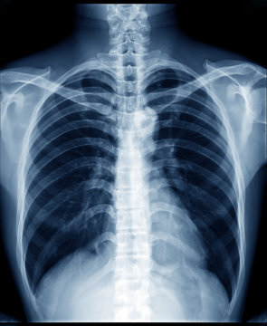

# RadEx - An Explainable Multi-Organ AI Framework for Chest X-Ray Diagnosis, Report Generation and Conversational Assistance

[](https://www.python.org/downloads/)
[](https://pytorch.org/)
[](LICENSE)

> **An end-to-end AI system for chest X-ray analysis with hierarchical multi-organ disease classification, automated report generation, and conversational assistance through RAG-powered chatbot.**



---

## 🌟 Key Features

- **🎯 Multi-Label Disease Classification**: Detects 16+ thoracic conditions across lungs, pleura, and heart
- **🧠 Hierarchical Architecture**: Organ-level + disease-level predictions with DenseNet121 backbone
- **📊 High Accuracy**: Achieves 79-89% AUROC across disease categories on NIH Chest X-ray14 dataset
- **📝 Automated Report Generation**: Structured radiology reports with confidence levels
- **💬 RAG-Powered Chatbot**: Conversational interface for explaining findings and answering questions
- **🍎 Optimized for Apple Silicon**: Runs efficiently on MacBook with MPS acceleration
- **⚖️ Calibrated Probabilities**: Platt scaling ensures honest probability estimates

---

## 📋 Table of Contents

- [Architecture](#architecture)
- [Performance](#performance)
- [Installation](#installation)
- [Dataset Setup](#dataset-setup)
- [Training](#training)
- [Evaluation](#evaluation)
- [Usage](#usage)
- [Project Structure](#project-structure)
- [Citation](#citation)
- [License](#license)

---

## 🏗️ Architecture

RadEx implements a **hierarchical two-level classification system**:

```
Chest X-Ray (224×224)
        ↓
DenseNet121 Backbone (pretrained)
        ↓
   Feature Vector (1024-dim)
        ↓
    ┌───────┴───────┐
    ↓               ↓
Organ Heads    Disease Heads
(3 organs)     (16 diseases)
    ↓               ↓
Organ Probs    Disease Probs
```

### Model Components

1. **Shared Backbone**: DenseNet121 (ImageNet or CheXpert pretrained)
2. **Organ-Level Heads**: Binary classifiers for lungs, pleura, heart
3. **Disease-Level Heads**: Multi-label classifiers for specific conditions within each organ

### Supported Conditions

**Lungs** (11): Atelectasis, Consolidation, Edema, Pneumonia, Infiltration, Mass, Nodule, Emphysema, Fibrosis, Lung Opacity, Lung Lesion

**Pleura** (3): Pleural Effusion, Pneumothorax, Pleural Thickening

**Heart** (2): Cardiomegaly, Enlarged Cardiomediastinum

---

## 📊 Performance

### Test Set Results (25,596 images)

| Condition | AUROC | Sensitivity | Specificity | Test Cases |
|-----------|-------|-------------|-------------|------------|
| **Emphysema** | 0.885 [0.874-0.893] | 92.0% | 60.9% | 1,093 |
| **Cardiomegaly** | 0.889 [0.879-0.899] | 87.0% | 72.7% | 1,069 |
| **Pneumothorax** | 0.855 [0.848-0.861] | 91.6% | 57.5% | 2,665 |
| **Edema** | 0.841 [0.831-0.851] | 85.2% | 68.5% | 925 |
| **Fibrosis** | 0.824 [0.809-0.843] | 79.8% | 69.5% | 435 |
| **Pleural Effusion** | 0.817 [0.810-0.824] | 91.2% | 52.2% | 4,658 |
| **Mass** | 0.811 [0.802-0.822] | 73.1% | 74.5% | 1,748 |

**Overall Mean Disease AUROC**: 79.1%

**Organ-Level Performance**:
- Heart: 88.9% AUROC
- Lungs: 73.7% AUROC

---

## 🚀 Installation

### Prerequisites

- Python 3.8 or higher
- macOS with Apple Silicon (M1/M2/M3) or CUDA-capable GPU
- 8GB+ RAM recommended
- ~60GB free disk space for datasets

### Setup

```bash
# Clone the repository
git clone https://github.com/David-Ajay/RadEx.git
cd RadEx

# Create virtual environment
python3 -m venv .venv
source .venv/bin/activate  # On Windows: .venv\Scripts\activate

# Install dependencies
pip install -r requirements.txt

# Install package in development mode
pip install -e .

# Verify installation
python scripts/00_check_env.py  # Should show MPS/CUDA available
```

---

## 📦 Dataset Setup

RadEx uses the **NIH Chest X-ray14** dataset (~42GB) and optionally **CheXpert** (~11GB).

### Step 1: Get Kaggle Credentials

1. Go to [kaggle.com](https://kaggle.com) → Settings → API
2. Click "Create New Token" → downloads `kaggle.json`
3. Place it in the correct location:

```bash
mkdir -p ~/.kaggle
mv ~/Downloads/kaggle.json ~/.kaggle/
chmod 600 ~/.kaggle/kaggle.json
```

### Step 2: Download Data

```bash
# Download NIH dataset (~42 GB, required)
bash scripts/01_download_data.sh nih

# Optional: Download CheXpert (~11 GB)
bash scripts/01_download_data.sh chexpert

# Build unified label CSV
bash scripts/02_build_labels.sh  # Creates data/labels/master.csv

# Preprocess images (resize, normalize, convert to JPEG)
bash scripts/03_preprocess_images.sh --limit 500  # Quick test first
bash scripts/03_preprocess_images.sh              # Full preprocessing (resumable)
```

**Note**: The dataset is automatically excluded from git via `.gitignore`. See [DATA_SETUP.md](DATA_SETUP.md) for details.

---

## 🏋️ Training

### Quick Smoke Test (2000 images, 1 epoch)

```bash
python -m radexplain.train --subset 2000 --epochs 1
# Saves to: checkpoints/smoke/
```

### Full Training (5 epochs, ~77k images)

```bash
python -m radexplain.train
# Saves to: checkpoints/phase1/
```

### Training with X-Ray Pretrained Backbone

```bash
# Download CheXpert-pretrained weights
python scripts/11_get_xray_weights.py

# Train with X-ray backbone
python -m radexplain.train --config train_xray.yaml --name xray_chex
```

### Resume Training

```bash
python -m radexplain.train --resume
```

**Training Hyperparameters** (configurable in `configs/train.yaml`):
- Epochs: 5
- Batch size: 32
- Learning rate: 0.0001
- Optimizer: AdamW
- Scheduler: Cosine annealing
- Image size: 224×224
- Backbone: DenseNet121

---

## 🧪 Evaluation

### Evaluate on Test Set

```bash
python -m radexplain.evaluate --name phase1 --bootstrap 200
```

**Outputs**:
- `checkpoints/phase1/postprocess.json` - Calibration parameters & thresholds
- `outputs/phase1/test_metrics.json` - Per-disease performance metrics
- `outputs/phase1/test_metrics.csv` - Results in CSV format
- `outputs/phase1/roc_test.png` - ROC curves visualization

### Metrics Computed

- **AUROC** with 95% bootstrap confidence intervals
- **AUPRC** (Precision-Recall)
- **Sensitivity & Specificity** at optimal thresholds
- **Brier Score** (before/after calibration)

---

## 💻 Usage

### Web Application (Streamlit)

```bash
streamlit run src/radexplain/app/main.py
```

Open browser at [http://localhost:8501](http://localhost:8501)

### Predict on Single Image

```bash
python -m radexplain.predict \
  --checkpoint checkpoints/phase1/best.pt \
  --image path/to/xray.jpg \
  --output predictions.json
```

### Batch Prediction

```python
from radexplain.predict import load_model, predict_image

model, postprocess = load_model("checkpoints/phase1/best.pt")
results = predict_image(model, postprocess, "xray.jpg")

print(f"Organ predictions: {results['organ']}")
print(f"Disease predictions: {results['disease']}")
```

---

## 📁 Project Structure

```
RadEx/
├── configs/              # Training and RAG configurations
│   ├── train.yaml
│   ├── train_xray.yaml
│   └── rag.yaml
├── src/radexplain/       # Main source code
│   ├── models/           # Model architecture
│   │   ├── radexplain_net.py
│   │   └── losses.py
│   ├── data/             # Dataset and data loading
│   │   └── dataset.py
│   ├── app/              # Streamlit web application
│   │   └── main.py
│   ├── rag/              # RAG chatbot components
│   ├── train.py          # Training script
│   ├── evaluate.py       # Evaluation script
│   └── predict.py        # Inference script
├── scripts/              # Setup and preprocessing scripts
├── checkpoints/          # Model weights (gitignored)
├── data/                 # Datasets (gitignored)
│   ├── raw/              # Original datasets
│   ├── processed/        # Preprocessed images
│   └── labels/           # Label CSV files
├── outputs/              # Training logs and metrics
└── requirements.txt      # Python dependencies
```

---

## 🔧 Configuration

### Environment Variables

Copy `.env.example` to `.env` and configure:

```bash
cp .env.example .env
```

**Key variables**:
- `OPENAI_API_KEY` - For RAG chatbot (optional)
- `HF_TOKEN` - Hugging Face token for embedding models (optional)

### Training Configuration

Edit `configs/train.yaml` to customize:
- Model backbone (densenet121, resnet50, resnet18)
- Batch size, learning rate, epochs
- Data augmentation parameters
- Loss weights for organ vs disease

---

## 🔬 Methodology Highlights

1. **Hierarchical Classification**: Joint organ-level and disease-level predictions
2. **Class Imbalance Handling**: Weighted BCE loss with per-label positive weights (1-20x)
3. **Probability Calibration**: Platt scaling on validation set for honest probabilities
4. **Threshold Optimization**: Youden's J statistic maximizes sensitivity + specificity
5. **Patient-Level Splitting**: Ensures no patient appears in multiple splits
6. **Masked Loss**: Ignores unannotated labels (NaN handling)

---

## 📚 Citation

If you use RadEx in your research, please cite:

```bibtex
@software{radex2024,
  author = {David Ajay},
  title = {RadEx: An Explainable Multi-Organ AI Framework for Chest X-Ray Diagnosis},
  year = {2024},
  url = {https://github.com/David-Ajay/RadEx}
}
```

---

## 🙏 Acknowledgments

- **NIH Clinical Center** - Chest X-ray14 dataset
- **Stanford ML Group** - CheXpert dataset
- **TorchXRayVision** - Pretrained chest X-ray models
- **PyTorch & Torchvision** - Deep learning framework

---

## 📄 License

This project is licensed under the MIT License - see the [LICENSE](LICENSE) file for details.

---

## 🤝 Contributing

Contributions are welcome! Please feel free to submit a Pull Request.

1. Fork the repository
2. Create your feature branch (`git checkout -b feature/AmazingFeature`)
3. Commit your changes (`git commit -m 'Add some AmazingFeature'`)
4. Push to the branch (`git push origin feature/AmazingFeature`)
5. Open a Pull Request

---

## 📧 Contact

**David Ajay**
- GitHub: [@David-Ajay](https://github.com/David-Ajay)

---

## ⭐ Star History

If you find this project useful, please consider giving it a star! ⭐

---

**Made with ❤️ by David Ajay**
